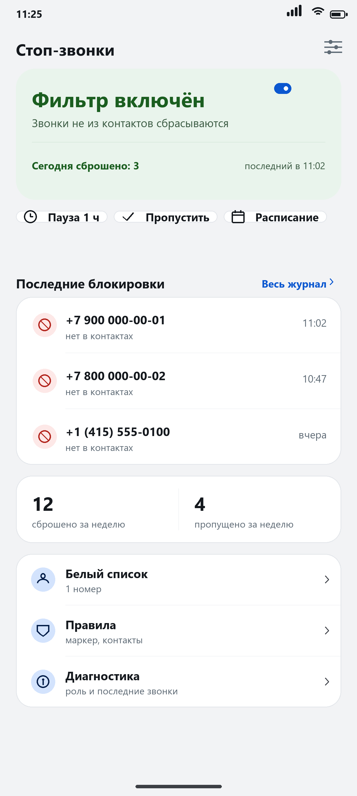
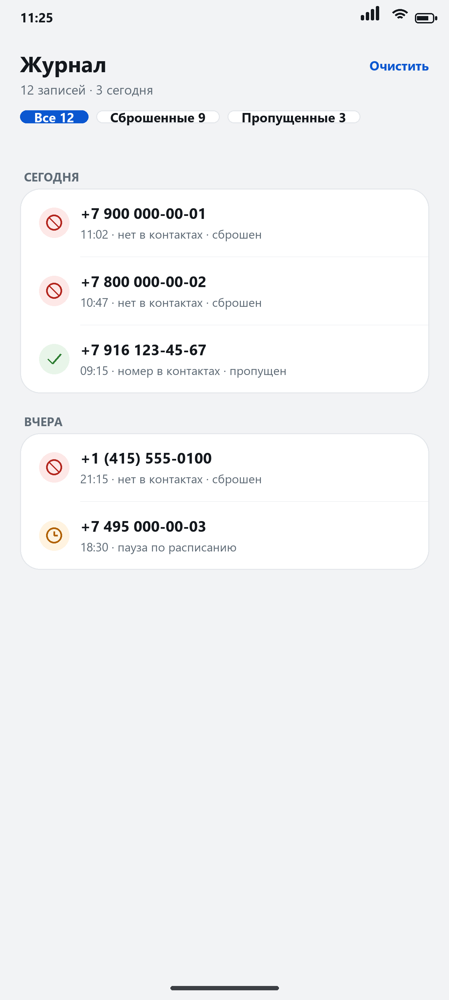
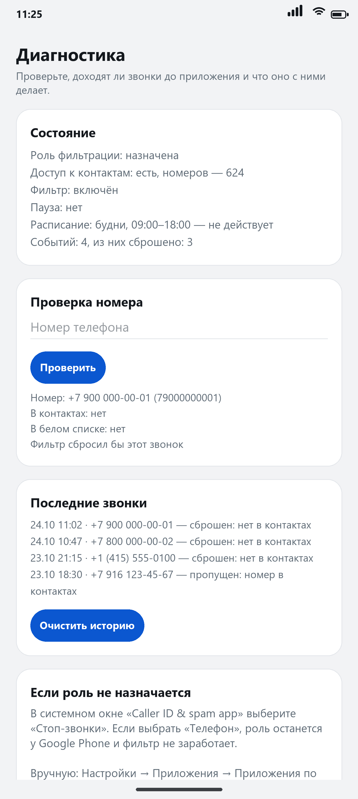
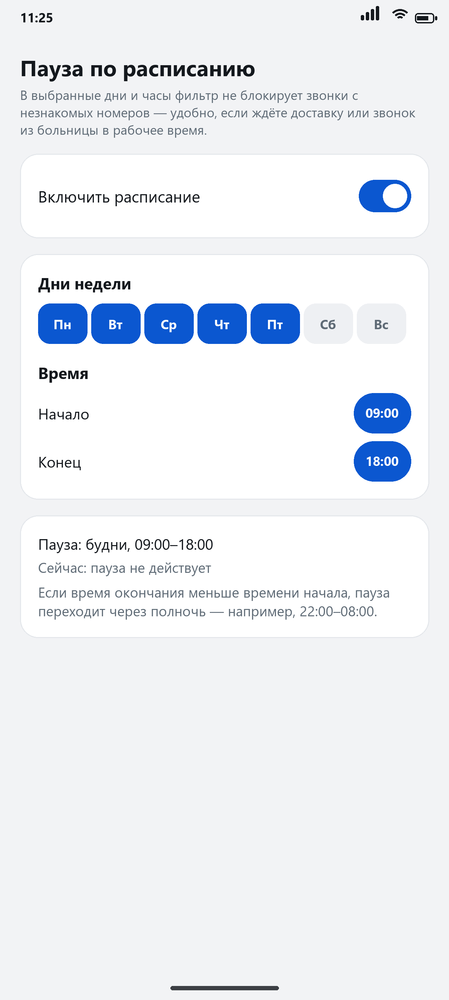

# Стоп-звонки (CallGuard)

Приложение для Android, которое сбрасывает входящие звонки с номеров, которых нет
в вашей адресной книге, и ведёт журнал таких звонков.

**Скачать:** [последняя версия в Releases](https://github.com/garneva13/stop-calls/releases/latest)
· **Страница проекта:** [garneva13.github.io/stop-calls](https://garneva13.github.io/stop-calls/)

Android 11 и новее (minSdk 30), APK ~90 КБ, лицензия MIT.

Как выглядит:

| Главный экран | Журнал |
|---|---|
|  |  |
| **Диагностика** | **Пауза по расписанию** |
|  |  |

На телефоне шрифт будет системный (Roboto), переключатель — системный Pixel, поэтому
детали могут отличаться от картинки.

---

## Что умеет

| Возможность | Где в приложении |
|---|---|
| Сброс звонков с номеров не из контактов (до первого гудка) | переключатель в цветном блоке состояния |
| Журнал всех звонков: номер, дата, причина, маркер | «Весь журнал» или иконка «Журнал» |
| Полное выключение фильтра | тот же переключатель |
| Пауза на 1 час (ждали курьера, врача) | чип «Пауза 1 ч» |
| Пауза по расписанию: дни недели + часы | чип «Расписание» |
| Пропустить ровно один незнакомый звонок (15 минут) | чип «Пропустить» |
| Белый список номеров, которые проходят всегда | строка «Белый список» |
| Опциональная блокировка звонков без маркера проверки | строка «Правила» |
| Диагностика: доходят ли звонки, что решено и почему | строка «Диагностика» |

Сеть приложению нужна ровно для одного действия — проверки обновлений на GitHub
(`api.github.com`). Никаких данных о звонках, контактах или журнале оно не
отправляет; журнал, белый список и настройки хранятся только на телефоне. Если
не пользоваться кнопкой «Проверить обновление», сетевая активность нулевая:
обновляться можно вручную файлом. Батарею приложение не расходует — система сама
запускает его на время звонка.

---

## Установка

1. Скачайте APK из [Releases](https://github.com/garneva13/stop-calls/releases/latest)
   или перекиньте файл на телефон любым способом (USB, облако, «Избранное»).
2. Откройте файл в файловом менеджере и нажмите «Установить». Если система
   спросит про установку из неизвестного источника — разрешите для этого
   приложения (Настройки → Приложения → Специальный доступ → Установка
   неизвестных приложений).
3. Либо по USB с компьютера:
   ```
   adb install -r CallGuard-1.5.apk
   ```

APK подписан отладочным ключом — для личной установки это нормально, в Google Play
такое приложение не публикуется. Обновления ставятся поверх, если ключ тот же
(скрипт сборки хранит `build/debug.keystore`).

---

## Настройка (три шага, один раз)

1. **Доступ к контактам** — кнопка «Разрешить» → в системном окне «Разрешить».
2. **Роль «Фильтрация вызовов»** — кнопка «Назначить» → в системном окне выбрать
   **«Стоп-звонки»**. Важно: в списке есть и «Телефон» — если выбрать его, роль
   останется у Google Phone, Android не будет передавать звонки приложению, и
   фильтр не заработает (звонки проходят, журнал пустой).
   Если окно не появилось: *Настройки → Приложения → Приложения по умолчанию →
   Caller ID & spam app → «Стоп-звонки»*. На Pixel то же самое доступно из
   приложения «Телефон»: ⋮ → Настройки → Caller ID & spam → Caller ID & spam app.
3. Убедитесь, что переключатель в верхнем цветном блоке включён, а сам блок
   зелёный и в нём написано «Фильтр включён».

Если чего-то не хватает, блок состояния становится серым и сам подсказывает, что
сделать: при отсутствии роли по нему можно нажать и сразу открыть системный выбор,
при отсутствии доступа к контактам сверху появляется полоса с кнопкой «Разрешить».
Иначе фильтр молча не работает.

### Как проверить, что работает

Позвоните на телефон с другого номера, которого нет в контактах. Телефон не
должен звонить, а в журнале появится запись с номером и временем. Затем позвоните
с номера, который есть в контактах — звонок должен пройти как обычно.

Если звонок прошёл, откройте **«Диагностика»**:

* в разделе «Состояние» видно, назначена ли роль и выдан ли доступ к контактам;
* в «Последние звонки» — доходят ли звонки до приложения вообще. Пустой список
  при звонящем телефоне означает, что роль не у приложения: Android его не
  вызывает;
* в «Проверка номера» можно ввести номер, с которого звонили, и увидеть, считает
  ли приложение его контактом (и с каким именем) — это отвечает на вопрос
  «почему пропустило именно этот звонок».

---

## Пауза по расписанию

Блок состояния → чип «Расписание»:

* **Дни недели** — отметьте нужные (по умолчанию Пн–Пт).
* **Время** — начало и конец. Нажатие на «09:00» открывает системный выбор времени.

В выбранные дни и часы фильтр не блокирует незнакомые номера — удобно, если вы
ждёте доставку или звонок из больницы в рабочее время, а вечером хотите, чтобы
фильтр снова работал сам.

Детали:

* Расписание **независимо** от ручной паузы и от выключателя: если фильтр выключен
  целиком, расписание ни на что не влияет.
* Если время окончания меньше времени начала, окно переходит **через полночь**:
  `22:00–08:00` в понедельник значит «с 22:00 понедельника до 08:00 вторника».
  Дни считаются по дню **начала** окна.
* Когда пауза действует, на главном экране сверху жёлтым написано «Пауза по
  расписанию», а в журнале у таких звонков причина «Пауза по расписанию».
* Настройка сохраняется и переживает перезагрузку телефона.

---

## Ограничения, о которых нужно знать

**1. Скрытые и приватные номера не блокируются.** Система вообще не передаёт
такие вызовы приложениям-фильтрам — это ограничение Android, а не приложения.
Чтобы закрыть и эту дырку, включите системную блокировку неизвестных вызовов:
*Телефон → ⋮ → Настройки → Заблокированные номера → «Неизвестные»*. Тогда
звонки без определившегося номера не будут трезвонить.

**2. Роль фильтрации — одна на телефон.** Назначив её «Стоп-звонкам», вы
отключаете встроенный определитель номеров Google и функцию Call Screen. Вернуть
можно в том же системном окне, выбрав Google. Проверьте это перед тем, как оставить
приложение насовсем.

**3. Маркер проверки номера (STIR/SHAKEN).** Это подтверждение номера
оператором. В России он практически не передаётся, поэтому галочка «Блокировать
звонки без маркера» по умолчанию выключена: если её включить, под блокировку
попадут и звонки от ваших контактов. В журнале маркер показывается для каждой
записи, так что видно, приходил он или нет.

**4. Сверка номеров — по последним 10 цифрам.** `+7 916 123-45-67`,
`8 (916) 123-45-67` и `9161234567` считаются одним и тем же номером. Это сделано
специально, потому что операторы и контакты хранят номера в разном виде.

**5. Только входящие.** Исходящие звонки приложение не трогает.

**6. Если роль отозвана или приложение удалено — блокировки нет.** Журнал и
белый список хранятся только на телефоне и удаляются вместе с приложением.

**7. Незнакомый, но нужный номер.** Курьер, больница, служба доставки — добавьте
номер в «Белый список» один раз, и он будет проходить всегда. Разово — чип
«Пропустить».

---

## Как это устроено

```
app/src/main/
├── AndroidManifest.xml          разрешение READ_CONTACTS + CallScreeningService
├── java/com/callguard/
│   ├── CallGuardService.java    системный сервис: решает «пропустить/сбросить»
│   ├── ContactIndex.java        кэш номеров из контактов (TTL 5 минут)
│   ├── PhoneNumbers.java        нормализация и сверка номеров (без Android API)
│   ├── DbHelper.java            SQLite: события звонков + белый список
│   ├── Settings.java            переключатель, пауза, разовый пропуск
│   ├── MainActivity.java        главный экран
│   ├── LogActivity.java         журнал блокировок
│   ├── WhitelistActivity.java   белый список
│   ├── DiagnosticsActivity.java состояние, проверка номера, последние звонки
│   ├── ScheduleActivity.java    пауза по расписанию: дни, время
│   ├── AboutActivity.java       версия, проверка обновлений, установка из файла
│   ├── UpdateManager.java       GitHub Releases API + PackageInstaller
│   ├── InstallReceiver.java     результат установки APK
│   ├── Schedule.java            правила окна (через полночь) — без Android API
│   ├── ScheduleUi.java          человекочитаемое описание расписания
│   ├── Reasons.java             причины решения и подписи маркера
│   ├── CallEvent.java / WhitelistEntry.java
└── res/                          разметка, строки (русский), темы, иконка
```

Ключевые решения:

* **`CallScreeningService` + `ROLE_CALL_SCREENING`** — единственный поддерживаемый
  способ получить номер до вызова и отклонить его. Сервис привязывается системой
  на время звонка, поэтому фоновый сервис и уведомление не нужны.
* **Ответ обязателен в течение 5 секунд**, иначе звонок проходит. Поэтому номера
  контактов читаются один раз и кэшируются в памяти (`ContactIndex`), а сверка —
  это lookup по `HashSet`, а не запрос к провайдеру на каждом звонке.
* **Ошибка → пропустить.** Любое исключение в сервисе трактуется как «разрешить
  звонок»: лучше пропустить спам, чем потерять важный вызов.
* **Пишется каждое решение**, включая «пропущен» и причину (контакт, белый
  список, пауза, разовый пропуск). Именно это позволяет «Диагностике» ответить,
  почему конкретный звонок не сбросили, — и отличить «фильтр решил пропустить»
  от «Android вообще не вызвал приложение».
* **Отклонение**: `setDisallowCall(true)` + `setRejectCall(true)` — вызов
  сбрасывается, как если бы вы нажали «отклонить», а не уходит в голосовую почту.
* **Только framework API, без AndroidX и Material** — поэтому APK весит ~90 КБ
  и собирается без Gradle и без интернета.

---

## Выпуск новой версии

Репозиторий уже настроен: `update_repo` = `garneva13/stop-calls`, страница лежит
в `docs/index.html`. Остаётся выпустить релиз:

```powershell
.\build-apk.ps1 -Version 1.6 -VersionCode 7
```

Затем на GitHub: *Releases → Draft a new release*, тег **`v1.6`** (обязательно с
буквой `v`), прикрепить файл `dist/CallGuard-1.6.apk` и опубликовать.

Что произойдёт дальше: приложение по кнопке «Проверить обновление» запросит
`repos/garneva13/stop-calls/releases/latest`, сравнит `tag_name` со своей версией,
скачает APK из ассета релиза и передаст его системному установщику. Данные при
обновлении сохраняются.

Если в релизе нет APK, приложение честно скажет об этом; если релизов нет вовсе —
покажет `HTTP 404`.

### Если нужно поменять репозиторий или ссылки

Всё в одном месте — `app/src/main/res/values/strings.xml`:

```xml
<string name="update_repo" translatable="false">garneva13/stop-calls</string>
<string name="project_url" translatable="false">https://github.com/garneva13/stop-calls</string>
<string name="support_url" translatable="false">https://boosty.to/garneva13</string>
```

Пустой `support_url` скрывает кнопку «Поддержать» в приложении; сейчас там ссылка на
Boosty — она же стоит на странице `docs/index.html`.

### Важно

* Репозиторий должен быть публичным: токен в клиент вшивать нельзя.
* **Не коммитьте `keystore/debug.keystore`** — с ним кто угодно сможет подписать
  «обновление» вашей подписью и поставить его поверх. Он уже в `.gitignore`.

* Тег релиза начинайте с `v` (`v1.5`) — парсер это учитывает.
* Без токена GitHub отдаёт 60 запросов в час с IP — для ручной проверки хватает.

---

## Сборка из исходников

Нужны JDK 17 и Android SDK (platform android-34, build-tools 35.0.0). Ни Gradle,
ни интернет не требуются.

```powershell
cd B:\DeepSeek\callguard
powershell -NoProfile -ExecutionPolicy Bypass -File .\build-apk.ps1 -Clean
```

Скрипт делает всё по шагам и падает с понятной ошибкой, если чего-то не хватает:

1. `aapt2 compile` — скомпилировать ресурсы;
2. `aapt2 link` — собрать APK-каркас и сгенерировать `R.java`;
3. `javac` — скомпилировать Java (класс-файлы Java 8, `android.jar` как bootclasspath);
4. `d8` — dex;
5. упаковка `classes.dex`, проверка что `resources.arsc` не сжат (требование Android 11+);
6. `zipalign`, `apksigner` (v2 + v3), проверка подписи;
7. результат копируется в `dist/CallGuard-<версия>.apk`.

Параметры: `-Version 1.2 -VersionCode 3` для новой версии, `-MinSdk`, `-TargetSdk`.

### Самотесты логики

Обе «умные» части вынесены в классы без Android API, поэтому проверяются на
обычной JVM:

```powershell
$jdk = 'C:\Program Files (x86)\Android\openjdk\jdk-17.0.14\bin'

# номера: 31 проверка
& "$jdk\javac.exe" -encoding UTF-8 -d tools\out `
    app\src\main\java\com\callguard\PhoneNumbers.java tools\PhoneNumbersSelfTest.java
& "$jdk\java.exe" -cp tools\out com.callguard.PhoneNumbersSelfTest

# расписание: 28 проверок
& "$jdk\javac.exe" -encoding UTF-8 -d tools\out `
    app\src\main\java\com\callguard\Schedule.java tools\ScheduleSelfTest.java
& "$jdk\java.exe" -cp tools\out com.callguard.ScheduleSelfTest
```

Проверяются форматы `+7` / `8` / 10 цифр, международные номера, `tel:`-префиксы,
сравнение по последним 10 цифрам, а для расписания — границы окна, переход через
полночь и маски дней (в том числе «воскресенье 22:00 → понедельник 02:00»).

---

## Частые вопросы

**Звонок прошёл, а в журнале пусто.** Роль досталась другому приложению (скорее
всего Google Phone): Android передаёт звонки только одному фильтру. На главном
экране в этом случае серое «Не активировано» — нажмите на блок состояния и
выберите **«Стоп-звонки»**, а не «Телефон». Подробности — в «Диагностике».
Проверить можно и вручную: Настройки → Приложения → Приложения по умолчанию →
Caller ID & spam app.

**Телефон всё равно звонит со незнакомых номеров.** Проверьте по порядку: роль
назначена (в системном окне выбран «Стоп-звонки»), доступ к контактам выдан,
переключатель включён, пауза не активна. Все четыре пункта видны на главном
экране и в «Диагностике».

**Заблокировало нужный звонок.** Добавьте номер в «Белый список», либо заранее
нажмите чип «Пропустить» (одноразово, 15 минут), либо «Пауза 1 ч».

**Нужно срочно выключить фильтр.** Переключатель на главном экране — это
единственный выключатель, он действует сразу же, в том числе во время звонка.

**Журнал быстро растёт?** Хранятся последние 1000 записей, старые удаляются
автоматически. Кнопка «Очистить» в журнале удаляет всё.
